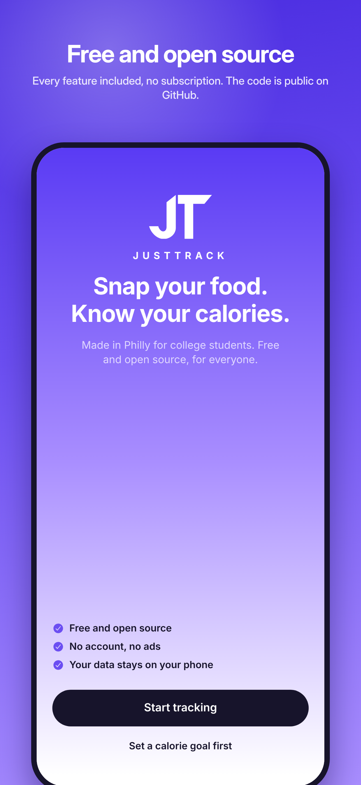
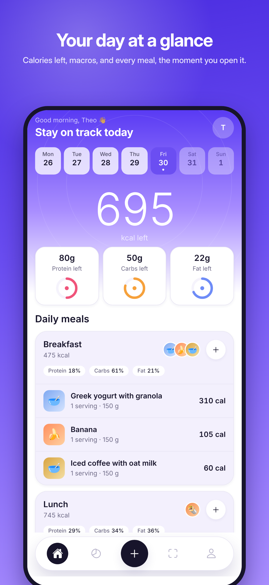
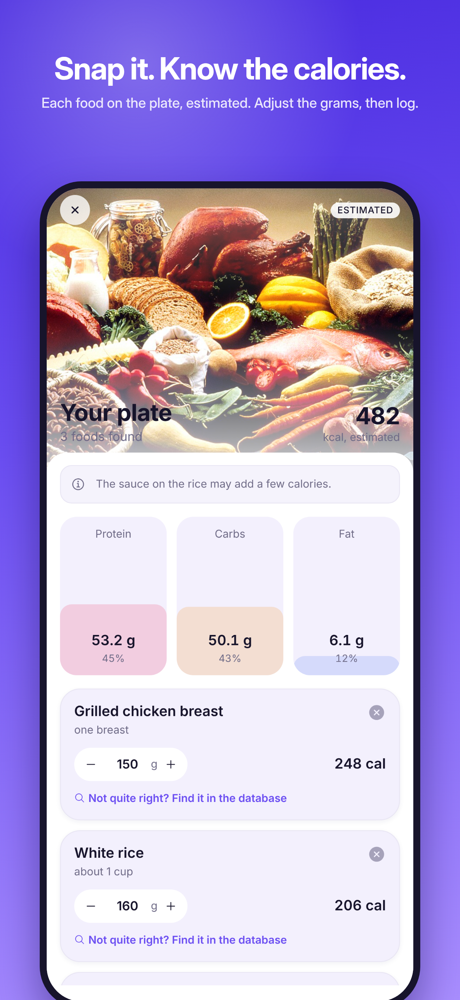
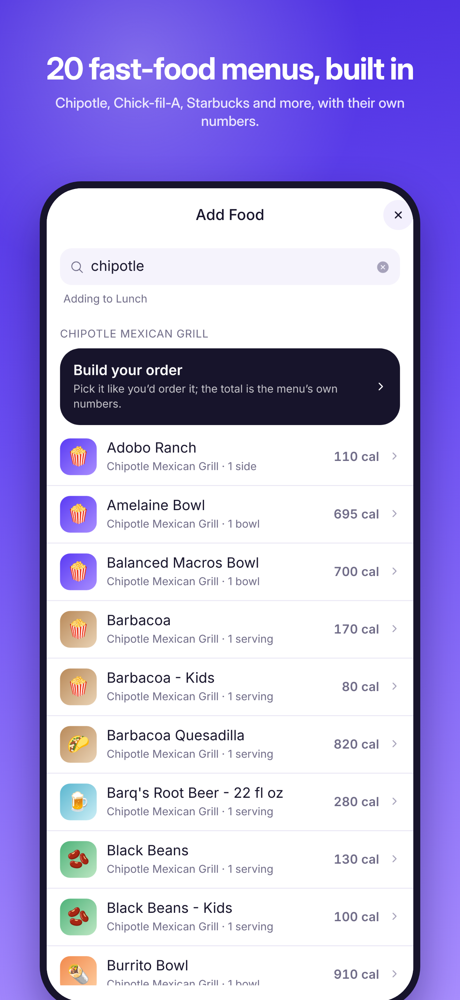
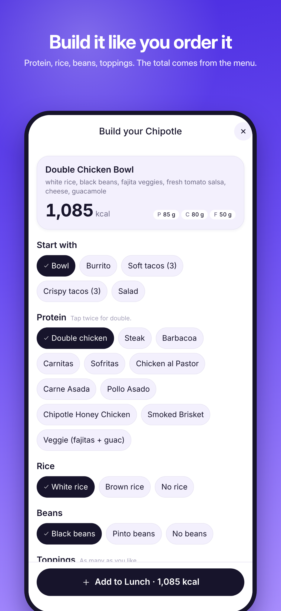
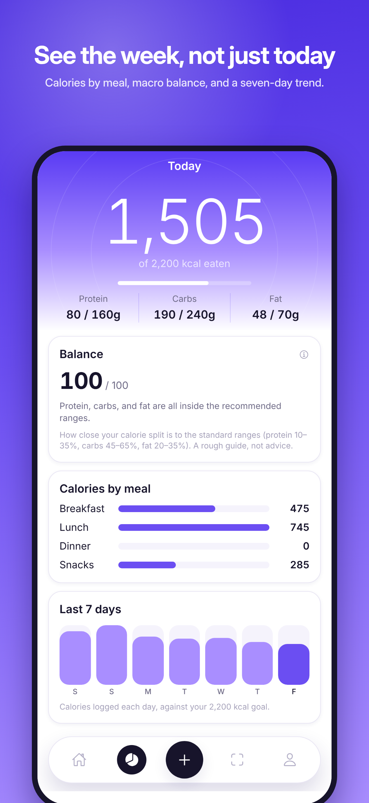
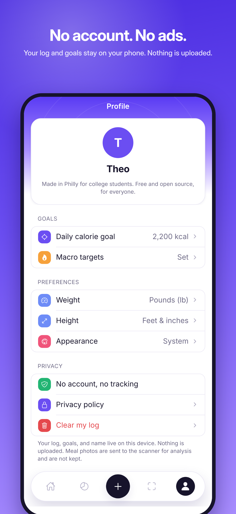

# JustTrack — free, open-source calorie tracker for iOS and web

**Role:** Founder, product designer, and developer (solo)
**Stack:** React Native · Expo SDK 57 · Expo Router · TypeScript · Vercel serverless (Node) · Google Gemini (vision) · Jest · Playwright
**Links:** [Source on GitHub](https://github.com/theokkk4/JustTrack) · [Web app](https://justtrack-snowy.vercel.app) · App Store (link once approved)

## One-line

A calorie tracker with no account, no ads, and no subscription: photograph a meal and get per-item nutrition estimates, or log from 30 built-in restaurant menus, with everything stored on the phone.

## What it does

- **Photo logging.** Point the camera at a plate; a vision model identifies each food, estimates the portion, and returns calories and macros. Results are labelled *Estimated* and every value is editable before it's logged.
- **30 restaurant chains, 8,500+ items, offline.** McDonald's, Chick-fil-A, Chipotle, Starbucks, Taco Bell, and 15 more, with the chains' own nutrition numbers bundled in the app.
- **Order builders.** Searching Chipotle, Subway, Panda Express, or Jersey Mike's opens a builder where you pick protein, rice, beans, toppings, size, and sides exactly as you'd order at the counter.
- **Everyday foods and barcodes** from the USDA database and Open Food Facts, with duplicate-aware search.
- **Day and week views.** Calories left, macro rings, meals by time of day, seven-day trend.
- **Private by design.** No sign-up, no analytics SDKs; the log lives in on-device storage.

## Screenshots

| | | |
| --- | --- | --- |
|  |  |  |
|  |  |  |

## Engineering highlights

- **One codebase, two platforms.** Expo Router app that ships to iOS through EAS Build and to the web on Vercel, where desktop visitors see it inside an iPhone-shaped frame.
- **Vision pipeline.** Photos are resized on-device, sent to Gemini with a strict JSON schema, and validated before anything reaches the UI. The web build keeps the API key server-side in a Vercel function; the iOS build calls the model directly.
- **Restaurant data pipeline.** A Node script harvests and normalises chain menus from the FatSecret Platform API (OAuth 1.0), merges re-runs, and emits a compact bundled dataset. Chain detection and ranking run locally, so searching "chipotle" is instant.
- **Data-driven order builders.** Each chain is a declarative config (steps, options, multipliers); one generic screen renders all four, and totals are computed from the same menu rows used in search.
- **Quality bar.** 170 Jest tests, a 16-step Playwright end-to-end suite against the production web build (including a fake-camera scan flow), TypeScript strict mode, and a lint pass on every change.
- **Store launch.** Automated the App Store Connect listing with EAS Metadata, produced framed 6.9" screenshots from the real app with Playwright, and wrote the privacy policy and support pages the listing requires.

## Resume bullets (pick two or three)

- Built and shipped **JustTrack**, a free, open-source calorie-tracking app for iOS and web (React Native, Expo, TypeScript), from design through App Store submission.
- Designed a photo-to-nutrition pipeline using a vision LLM with schema-validated JSON output, on-device image preprocessing, and a serverless proxy that keeps credentials off the client.
- Harvested and normalised 8,500+ menu items from 20 restaurant chains into an offline dataset, with instant local search and interactive order builders for four chains.
- Maintained a 170-test Jest suite and a Playwright end-to-end suite run against production builds.

## Short bio line

JustTrack is a calorie tracker I built because the good ones cost money and the free ones sell your data. It's free, open source, and keeps your log on your phone.
